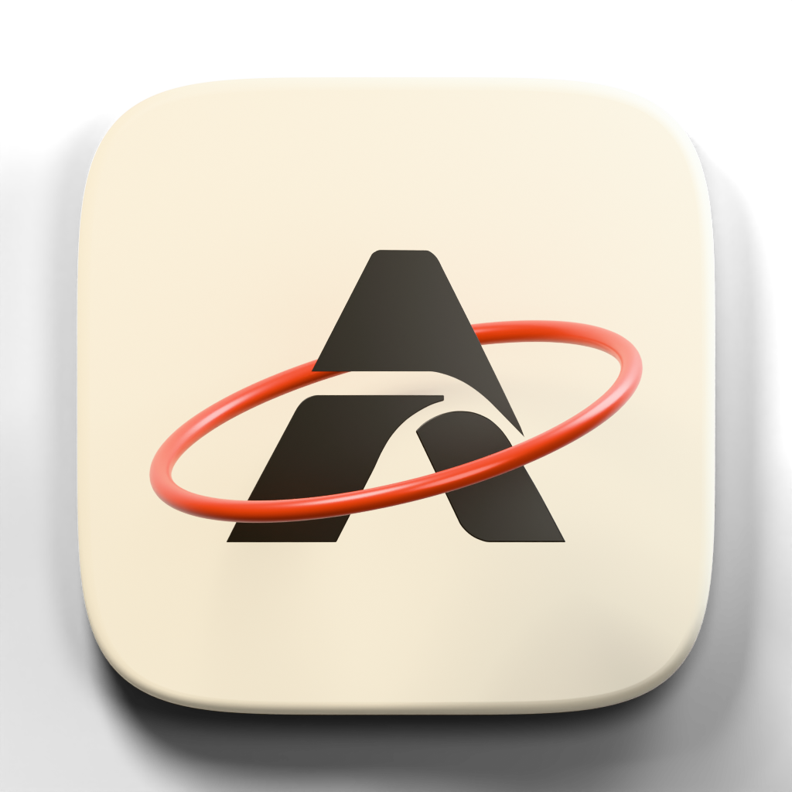

# AxioSozo browser

AxioSozo is a Zen (Firefox/Gecko) fork. **Zen/Gecko is the application.** Two more web
engines can render a tab, each out of process and presented inside Zen's own content area
(no Electron, iframe, UA spoofing or external engine window):

| Engine | How it runs | macOS (Apple silicon) | Linux (x86_64) |
| --- | --- | --- | --- |
| Gecko | Zen itself | builds and runs | builds, runs, GUI harness PASS |
| Chromium | sandboxed CEF 154 host (`native/chromium-host`) | IOSurface zero-copy view (engine-surface-v1) | AXCF frames over a pipe / sealed memfd, native frame receiver; E1/E2 + feel matrix PASS in CI (fixture and loopback web) |
| WebKit | WPE WebKit 2.48.3 host in bubblewrap (Linux); WKWebView host (macOS) | host component PASS; **in-Zen E2E NOT_VERIFIED** | fixture page only, E2E + feel matrix PASS in CI (EXPERIMENTAL) |

**Not READY.** This is a development prototype. Chromium web mode is behind a developer gate,
WebKit is fixture-only, macOS E1/E2 for WebKit has not been run, and nothing here was verified on
GPU machines. Exact per-engine status with run ids: [capability matrix](docs/CAPABILITY_MATRIX.md),
[setup status](docs/SETUP_STATUS.md) and the [cloud program summary](docs/CLOUD_PROGRAM_SUMMARY.md)
(Linux, WebKit, native feel, performance; evidence index and known gaps). Security review of the
cloud work: [docs/SECURITY_REVIEW_CLOUD.md](docs/SECURITY_REVIEW_CLOUD.md).

Earlier macOS milestones: the [26 September continuation](docs/PROVIDER_ENGINE_PROGRESS.md) adds
direct provider conversation wiring, per-tab Chromium web-mode code, lazy process startup and
simpler Zen defaults; live provider checks stopped before model requests, and the CEF Keychain
runtime gate remained unresolved on the owner's Mac. The raw development evidence contains
machine-specific logs and stays local; [the evidence note](docs/evidence/README.md) explains this
public-source boundary.

## Linux (Ubuntu 24.04 x86_64)

Details: [docs/LINUX.md](docs/LINUX.md). Build output goes to `$AXIOSOZO_BUILD_ROOT` (or the
gitignored `.build/`); there is no volume to mount.

```sh
sudo apt-get install -y --no-install-recommends $(python3 scripts/linux_packages.py test build gui)
export AXIOSOZO_BUILD_ROOT=$HOME/axiosozo-build      # optional
./dev doctor
./dev setup --only cargo,tools,provider
./dev check && ./dev test
AXIOSOZO_SCCACHE=1 ./dev setup --only zen             # full Zen build (cold ~1h40 on 4 cores)
./dev gui-test --engine gecko --scenario all --screenshot out.png
```

Chromium on Linux: `python3 native/chromium-host/probe.py setup`, then
`python3 native/chromium-host/probe.py install-sandbox` (sudo; only where unprivileged user
namespaces are blocked, e.g. Ubuntu's AppArmor default) and `probe.py check`. The in-Zen Chromium
runs on Linux are driven by `scripts/cef_zen_e2e.py --app fetched --mode fixture|web` (it sets the
developer gates and a throwaway profile; "Open in → Chromium" in the tab context menu); the
interactive `./dev engine-probe` / `./dev web-probe` launchers were not exercised on Linux by the
cloud program (NOT_VERIFIED). WebKit on Linux needs the Debian 13 WPE pins (`native/webkit-host/probe.py setup`,
run in the pinned debian:13 container on CI), `AXIOSOZO_WEBKIT_BINARY=$AXIOSOZO_BUILD_ROOT/webkit/AxioWebKitHost`
and the profile pref `axiosozo.engines.webkit.enabled=true`; it then appears as "Open in → WebKit"
for the local test page only (`scripts/webkit_zen_e2e.py`, `scripts/webkit_package.py`). Instead of building Zen, a CI-built app can be fetched:
`./dev fetch-build` (docs/LINUX.md).

CI (GitHub Actions, results on the `ci-results` branch): `linux-ci` (check/test), `linux-zen-build`
/ `linux-perf-build` (the app), `linux-gui`, `linux-cef-host`, `linux-cef-zen`, `linux-webkit-host`,
`linux-webkit-zen`, `linux-gecko-feel`, `linux-perf` (A/B + soak), `macos-ci` (macOS regression
lane), `macos-webkit-host`. They run on pushes to `cloud/integration` and `dev` and on PRs into them.

## macOS (Apple silicon, owner layout)

From this project folder, the development contract is:

```sh
./dev doctor
./dev setup
./dev
```

`doctor` is read-only and currently exits nonzero because the browser is not READY.
`setup` checks pinned sources, bootstraps only audited toolchains, and builds the
coordinator, native CEF host and custom Zen app. The first Zen/Firefox build is a
large native build, not a Vite server. `./dev` reuses matching build stamps and
starts the real custom app with an owned development profile. If source changed,
run `./dev setup` before starting it again.

Our source, patches, contracts and documentation live in this project folder on
T9. This project currently assumes Wout's macOS/T9 development layout; the
setup scripts need adaptation for another machine. The source is kept separate
from build data, so the large pinned upstream working checkout, native build,
caches, dependencies, synthetic profiles and temporary files use the
project-only APFS volume `AxioSozoBuild` mounted at `/Volumes/AxioSozoBuild`, physically
stored inside `/Volumes/T9/Dev.sparsebundle`. `scripts/storage.py setup` mounts it
when needed (through the `mount-axiosozo` helper) and never creates a disk image.
Before external builds, the project calls `mount-dev-storage`, then the required
`dev-external` wrapper and `scripts/storage.py exec --` to override its temporary
and cache paths into the AxioSozoBuild volume. Browser scripts never move, resize,
detach or clean the shared DevStorage volume, and never detach Dev.sparsebundle.
Two build jobs are used on this 16 GiB Mac.
The pinned Node 22.22.3, Rust 1.95.0, Python 3.11.16 and GNU tar 1.35 tools pass
the current component doctor. The lockfile records exact upstream revisions and
archive hashes; network-enabled setup fetches only verified upstream URLs.

| Command | Behavior |
| --- | --- |
| `./dev doctor` | Read-only platform, storage, toolchain, build and provider metadata |
| `./dev setup` | Controlled pinned source/bootstrap/native builds; first build can take substantial time |
| `./dev` | Start verified custom Zen with its development profile; any tab can switch to Chromium from the tab menu |
| `./dev --profile second` | Use an explicitly separate development profile |
| `./dev check` | Rust formatting/clippy, JS/provider, Zen source and native CEF checks |
| `./dev test` | Deterministic Rust, IPC/lifecycle, provider/Jev, fixture and real CEF stream tests |
| `./dev smoke` | Owned Zen fixture/TLS inspection session; GUI assertions require observing that run |
| `./dev engine-probe` | Fresh E0, then owned Zen fixture session with explicit experimental switch |
| `./dev web-probe` | Fresh E0, then an owned HTTP/TLS fixture session with per-tab Chromium switching |
| `./dev provider-test codex --authorized` | Approved fixed diagnostic only; its dedicated profile currently requires login |
| `./dev provider-test claude-code --authorized` | Approved fixed diagnostic only; authentication is unavailable under confinement |
| `./dev provider-test antigravity --authorized` | Reports unsupported startup isolation; no live request |
| `./dev jev-test` | Optional synthetic decision diagnostic; key and explicit authorization required |

Switching a tab's engine: right-click the tab → **Open in** → Chromium / WebKit / Firefox (with
only Chromium configured the item reads "Open in Chromium"). On macOS, WebKit additionally needs
the host built (`native/webkit-host/mac/build.sh <build root>/webkit`),
`AXIOSOZO_WEBKIT_BINARY=<build root>/webkit/AxioWebKitMacHost` exported before `./dev engine-probe`,
and `axiosozo.engines.webkit.enabled=true` in that profile (fixture page only; steps in
[docs/CLOUD_PROGRAM_SUMMARY.md](docs/CLOUD_PROGRAM_SUMMARY.md#owner-verification-on-the-mac)).

In the 23 September baseline, CEF154's signed native host passed E0 with 26 real OSR frames, input, 2× Retina
resize, local GET navigation/back and clean shutdown. The authenticated AXCF pipe
passed a separate eight-frame native test with stale-target rejection and exact
generation changes on a browser-cache return. A separate manual macOS GUI probe
observed real CEF frames, typing, page2/back and an explicit return to Gecko in
the Zen window. The latest live macOS GUI probe kept Chromium active through
typing and a 5K fullscreen transition, then
returned to Gecko and exited without owned CEF profiles. The probe driver still
exits20 because it has no automated GUI assertions; no integrated screenshot file
was saved. The local CEF result binds the native source hashes, build stamp and
process-cleanup evidence.

Provider discovery reads metadata only. Ask AI uses the user's own Codex
(`codex exec --json`) and Claude Code (`claude -p` stream-json) with their own
sign-in, admitted by an offline capability check of the exact installed executable
instead of a version pin, so client updates are re-checked rather than refused
(docs/PROVIDERS.md). Antigravity remains unavailable because it has no way to turn
off its tools. No client, login UI, MCP server, hook,
paid model or Jev network request is started by discovery, setup or deterministic
tests. Provider fixtures are visibly `TEST_FIXTURE`; they do not certify live auth.
Jev is optional, and a Keychain failure never falls back to plaintext storage.
See [provider boundaries](docs/PROVIDERS.md).

Daily source changes use a controlled `Ctrl+C`, `./dev setup`, `./dev` rebuild and
restart. Stamps reject stale native source; no C++ hot reload is promised. A
second start of the same development profile respects its owner lock rather than
opening the profile twice. Shutdown targets only this session's process groups;
there is no broad `pkill`, default-browser change or access to personal profiles.

If setup stops, rerun it after checking [status](docs/SETUP_STATUS.md). Downloads
are checksum verified; existing checkouts and profiles are preserved. Do not reset
an unknown source checkout or delete another project's cache to recover space.
Inspect the named component evidence before changing an upstream pin. Security
updates are deliberate: review upstream advisories, update the lock and patch
manifest, rebuild, rerun checks and GUI probes, then publish only with separate
authorization. This local fork does not follow Zen's ordinary automatic update
channel.

The [architecture](docs/adr/001-architecture.md),
[dual-engine decision](docs/adr/002-dual-engine.md),
[upstream/licence notes](docs/UPSTREAMS.md) and
[handoff 2 entrypoints](docs/IMPLEMENTATION_HANDOFF.md) define the remaining work.
The current first-experience slice is tracked in
[implementation status](docs/IMPLEMENTATION_STATUS.md),
[UX flows](docs/UX_FLOWS.md), [capabilities](docs/CAPABILITY_MATRIX.md) and the
[test walkthrough](docs/TEST_WALKTHROUGH.md).
The original AxioSozo source is licensed under [MPL-2.0](LICENSE). Vendored
components and upstream patches retain their respective notices; see
[third-party notices](THIRD_PARTY_NOTICES.md).
Chromium's IME, downloads, permissions, certificate dialogs,
accessibility and crash recovery remain explicit release gates. Fullscreen fixture
rendering now works with a bounded 1.5× CEF render scale on this 5K display;
general-site fullscreen and safety UI are not certified.
